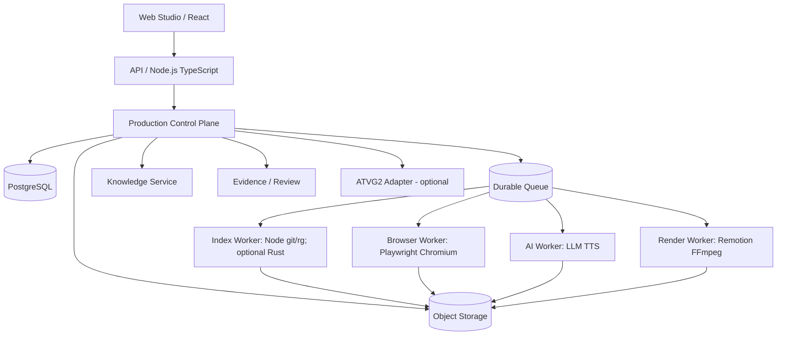

# 03 · 系统架构与技术选型

> Draft v0.1｜架构原则：模块化单体 Control Plane + 独立执行 Worker + 可替换适配器。

## 1. 总体架构



## 2. 技术栈决策

| 层 | 首选 | 理由 | 不采用的早期方案 |
|---|---|---|---|
| Monorepo | Nx + pnpm | 项目图、受影响构建、边界约束、任务缓存 | 无约束多仓库 |
| 前端 | React + TypeScript + Vite | 复杂编辑交互、快速开发 | 初期 SSR 过度设计 |
| API | Node.js LTS + Fastify 或 NestJS（二选一 ADR） | I/O、AI SDK、生态 | 全 Rust 重写 |
| 编排 | 持久化任务状态 + 队列；Mastra 仅用于 Agent 层（可选） | 可恢复、审批与确定性状态 | 仅靠 Agent 聊天循环 |
| 数据 | PostgreSQL | 事务、关系、JSONB、索引 | 首版独立图数据库 |
| 文件 | S3 兼容对象存储 | 大素材、hash、生命周期 | 数据库存大视频 |
| 浏览器 | Playwright + Chromium | 真实操作、trace、录屏 | 纯生成式 UI |
| 视频 | Remotion + FFmpeg | React 组合与原生媒体能力 | Node 手写编解码 |
| 代码检索 | git + ripgrep + AST 解析 | 快速增量与精确索引 | 每次全文送给 LLM |
| 原生加速 | Rust（达到基准后） | 并行索引、CPU 密集 | 首日强制 Rust |
| AI | 可替换 LLM/TTS/视觉服务 | 成本、质量、地域适配 | 单厂商硬绑定 |

## 3. Node 与 Rust 的性能边界

Node.js 负责 API、I/O、业务逻辑、Agent 工具调用、任务调度；CPU 密集任务不得长时间阻塞主事件循环。Chromium、Remotion、FFmpeg 在隔离进程/容器中运行。Rust 仅在 profiling 证明 Node + git/rg 方案无法满足索引性能或内存目标时引入。

**性能基准**：同一仓库/机器比较冷扫描、热扫描、PR 增量索引、峰值 RSS、吞吐、总成本；将 GitHub 网络延迟与 LLM 时间单独计量。不得凭语言偏好迁移。

## 4. 边界与依赖方向

- `apps/web` 仅依赖公开 UI SDK、contracts、client API；不得访问 DB。
- `apps/api` 依赖 domain/application/ports，外部服务通过 adapters 注入。
- `libs/domain-*` 不依赖具体框架、GitHub SDK、Remotion 或 ATVG2。
- `libs/contracts` 只包含稳定 DTO/Schema/事件定义，不包含网络调用。
- `workers/*` 只消费版本化 Job Envelope，输出 Artifact Manifest 和 Receipt。
- `libs/adapters-atvg2` 必须是可选适配层；核心包不得反向引用。
- 跨边界禁止深路径 import（例如从另一个应用直接 import `src/internal`）。

## 5. 数据流与一致性

1. Source Sync 生成不可变 `KnowledgeSnapshot`（含 git SHA、文档 hash、环境标识）。
2. Director 使用冻结快照生成 `VideoBrief` / `StoryboardV1`。
3. 用户批准后，编排器按 Scene DAG 投递 Job。
4. Worker 写临时文件并上传对象存储，返回 checksum + manifest；DB 事务提交 artifact metadata。
5. QA 验证 Claim、录屏、视频技术质量；审核后导出。

采用 **at-least-once delivery + 幂等处理**；不假设消息队列提供端到端 exactly-once。幂等键建议：`jobType + projectId + snapshotId + sceneRevision + inputDigest`。

## 6. API 设计示例

```text
POST /v1/projects
POST /v1/projects/:id/sources/github
POST /v1/projects/:id/knowledge-syncs
GET  /v1/projects/:id/features
POST /v1/video-projects
POST /v1/video-projects/:id/plan
POST /v1/video-projects/:id/approve
POST /v1/video-projects/:id/produce
GET  /v1/production-runs/:id
POST /v1/production-runs/:id/retry
POST /v1/production-runs/:id/cancel
POST /v1/video-projects/:id/exports
```

写操作需鉴权、租户校验、审计；长任务返回 `202 + runId`，前端通过 SSE/WebSocket 或轮询查看状态。接口契约由 Zod/OpenAPI 生成，版本化管理。

## 7. Worker 运行模型

| Worker | 资源限制 | 隔离 | 输出 |
|---|---|---|---|
| Knowledge | CPU/IO 配额 | 只读仓库快照 | 索引、Feature 候选 |
| Browser | Chromium 内存、超时 | 沙箱容器、受控域名 | 视频、截图、trace、assertions |
| AI | token/费用预算 | 受控工具权限 | 结构化 IR、语音素材 |
| Render | CPU/GPU、并发 | 独立容器/进程 | MP4、缩略图、校验报告 |

不能把浏览器 Worker 与 API 同进程部署。用户可取消任务，但取消需支持清理孤儿浏览器进程与临时文件。

## 8. 可靠性设计

- Job Envelope：`jobId`, `runId`, `tenantId`, `type`, `schemaVersion`, `inputRef`, `idempotencyKey`, `attempt`, `deadline`。
- 状态：queued/running/succeeded/failed/retryable/cancelled/blocked。
- 心跳与 lease；超时任务可回收；重试采用退避与最大次数。
- 有副作用的步骤需要 execution receipt；录屏重试前重置演示数据。
- 不可变输入快照与 artifact hash 支持重现；第三方生成式模型无法保证逐像素重现，应保存实际素材。
- API、队列、存储故障分别演练；告警基于失败率、队列等待、磁盘占用、成本异常。

## 9. 可观测性

每个任务记录 traceId、runId、sceneId、claimIds、artifactIds、模型/工具版本、耗时、重试次数、token/费用、CPU/RSS；日志默认脱敏。UI 必须能回答“现在在做什么、为什么卡住、谁能处理、哪些证据通过”。

## 10. ATVG2 解耦策略

定义三个候选协议：`ProductEventV1`、`EvidenceRefV1`、`CapabilityInvocationV1`。Standalone adapter 可在没有 ATVG2 的情况下完成所有 MVP 流程；ATVG2 adapter 只消费公开协议，不依赖其内部数据库/运行态。相关能力是否真实可复用需以集成测试证明，不能把设计文档当成实现。

## 11. 架构 ADR 待办

ADR-001 API 框架选择（已决定：Fastify，见 [ADR-001](adr/ADR-001-api-framework-fastify.md)）；ADR-002 队列（可考虑 pg-boss，但需评估运维与故障恢复）；ADR-003 对象存储；ADR-004 TTS/LLM 抽象；ADR-005 Rust 索引引入阈值；ADR-006 多租户数据隔离；ADR-007 视频编辑器预览策略；ADR-008 Step 3 工作区存储（已决定：SQLite，但仅用于工作区元数据，见 [ADR-008](adr/ADR-008-sqlite-workspace-storage.md)）。

**关联文档**：04 Nx、05 Data、06 Workflow、07 Media、08 Security。
