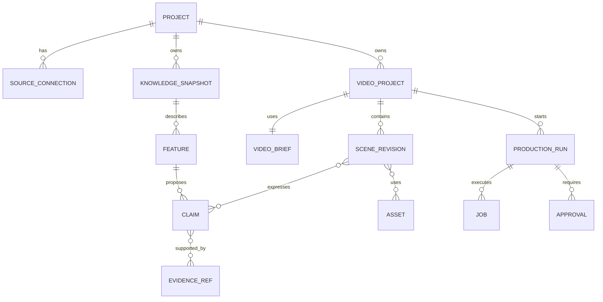

# 05 · 领域数据模型、IR 与协议

> Draft v0.1｜数据模型优先支持事实追溯、版本冻结、局部重渲染、跨运行时契约。

## 1. 聚合与实体

| 聚合 | 核心实体 | 生命周期 |
|---|---|---|
| Workspace | Tenant, Member, Project | 创建→授权→归档 |
| Source | SourceConnection, SourceRevision, SyncRun | 授权→同步→撤销 |
| Knowledge | KnowledgeSnapshot, Feature, Claim, EvidenceRef | 候选→验证→过期 |
| Video | VideoBrief, VideoProject, Storyboard, SceneRevision | 草稿→批准→制作 |
| Demo | DemoPlan, DemoExecution, AssertionResult | 规划→授权→执行 |
| Media | Asset, Narration, RenderManifest, Export | 采集→处理→发布 |
| Production | ProductionRun, Job, Checkpoint, Approval | 排队→执行→审核 |

每个租户资源必须有 `tenantId`；数据库读写强制租户范围过滤，关键表可评估 PostgreSQL RLS 作为纵深防御。使用 UUID/ULID 作为主键；时间统一 UTC ISO-8601。

## 2. 关键状态的区别

`Feature.status`：proposed / implemented / verified / deployed / available / deprecated。不要把这些状态当成必然单调流程：部署可能回滚、功能开关可能关闭。需要保留来源、环境和时间。

`Claim.status`：proposed / supported / verified / stale / rejected。`verified` 必须绑定 `VerificationContext`：commitSha、environmentId、appVersion、testRunId、verifiedAt、validityScope。

`Scene.status`：draft / approved / capture_ready / captured / assembled / review_required / approved / stale。

`ProductionRun.status`：created / knowledge_ready / planned / awaiting_approval / capturing / assembling / verifying / review_ready / approved / exported；异常：blocked / failed / cancelled。状态转移必须由应用服务检查，不允许客户端任意改状态。

## 3. 关系设计



**注意**：生产数据库中，KnowledgeSnapshot 与 Feature 应通过 snapshot membership 关联，避免修改 Feature 当前记录影响历史视频。Claim/Evidence 也要存不可变 revision 或 digest。

## 4. 核心 TypeScript 契约（示意）

```ts
export type ID = string;
export type ISODate = string;
export type SHA256 = string;

export interface KnowledgeSnapshotV1 {
  schemaVersion: '1';
  id: ID;
  projectId: ID;
  gitCommitSha?: string;
  sourceDigests: Record<string, SHA256>;
  environmentId?: ID;
  indexedAt: ISODate;
  featureRevisionIds: ID[];
}

export interface ClaimV1 {
  id: ID;
  featureRevisionId: ID;
  statement: string;
  audience: string;
  status: 'proposed' | 'supported' | 'verified' | 'stale' | 'rejected';
  evidenceRefs: ID[];
  verificationContext?: {
    commitSha?: string;
    environmentId?: ID;
    appVersion?: string;
    verifiedAt: ISODate;
    scope: string;
  };
}

export interface StoryboardV1 {
  schemaVersion: '1';
  videoProjectId: ID;
  briefRevisionId: ID;
  knowledgeSnapshotId: ID;
  fps: number;
  scenes: VideoSceneV1[];
}

export interface VideoSceneV1 {
  id: ID;
  revision: number;
  order: number;
  durationFrames: number;
  intent: string;
  narration: string;
  onScreenText: string[];
  claimIds: ID[];
  assetIds: ID[];
  visual:
    | { type: 'real_demo'; demoPlanId: ID }
    | { type: 'motion_graphics'; templateId: ID; props: Record<string, unknown> }
    | { type: 'generated_visual'; assetId: ID };
}

export interface JobEnvelopeV1 {
  schemaVersion: '1';
  jobId: ID;
  runId: ID;
  tenantId: ID;
  type: string;
  inputRef: ID;
  idempotencyKey: string;
  attempt: number;
  deadlineAt: ISODate;
}

export interface ArtifactReceiptV1 {
  schemaVersion: '1';
  jobId: ID;
  artifactId: ID;
  sha256: SHA256;
  mimeType: string;
  byteSize: number;
  storageRef: string;
  createdAt: ISODate;
}
```

生产代码须通过 Zod 等运行时 Schema 校验，不能只依赖 TS 编译期类型。所有事件都包含 schemaVersion；不兼容变更创建 V2，迁移要有契约测试。

## 5. DemoPlanV1

```ts
export interface DemoPlanV1 {
  schemaVersion: '1';
  id: ID;
  projectId: ID;
  environmentId: ID;
  allowedOrigins: string[];
  testCredentialRef?: string;
  resetStrategy: 'fixture' | 'snapshot' | 'manual';
  steps: Array<{
    id: ID;
    action: 'navigate' | 'click' | 'fill' | 'wait_for' | 'assert' | 'capture';
    target?: string;
    valueRef?: string;
    timeoutMs: number;
    assertion?: { kind: string; expected: unknown };
  }>;
  approvalId: ID;
}
```

`valueRef` 指向凭证/测试数据，不得把真实密码写入计划或日志。执行器应将 AI 规划转成白名单操作，拒绝任意 JavaScript/eval、任意外部 URL 或 shell 执行。

## 6. 依赖与失效传播

保存关系：`SourceRevision → FeatureRevision → ClaimRevision → SceneRevision → RenderArtifact`。

源文件/PR/部署版本变更后，只将有直接或间接依赖的 Claim、DemoPlan、Scene 标记 `stale`。允许用户查看差异、重新验证、重录受影响片段。失效不代表立刻删除历史视频；历史版本应可审计。

## 7. 缓存指纹

`sceneInputDigest = hash(sceneRevision + claimRevisionIds + assetHashes + templateVersion + fontRefs + narrationVoiceVersion + fps + renderSettings)`。

`renderInputDigest` 必须包含所有会影响输出的输入，包括 FFmpeg/Remotion 版本与渲染环境约束。对不确定的外部模型生成，缓存其**实际产物**，不能假设同一 prompt 重生成一致。

## 8. 数据库与存储

PostgreSQL：事务数据、关系、事件、索引元数据、状态、审批。对象存储：原始录屏、截图、音频、临时渲染、最终视频、manifest。大对象使用内容寻址或唯一 key，记录 checksum、MIME、大小、保留期限、租户所有权。使用 outbox 模式避免 DB 提交与队列投递之间的不一致。

## 9. 版本化规则

- `KnowledgeSnapshot` 不可变；同步生成新快照。
- `VideoBrief`、`Storyboard`、`Scene` 使用 revision；历史可查询。
- `Approval` 绑定批准对象的 revision/digest，修改后需重新批准。
- `Render` 固定输入 digest，输出 MP4/SRT/thumbnail manifest。
- 删除数据时考虑证据依赖与法规要求，实施可配置保留策略。

## 10. ATVG2 协议草案

`ProductEventV1`：功能/发布事件 + sourceRef + revision。`EvidenceRefV1`：证据 URI、digest、来源、验证范围、签发者。`CapabilityInvocationV1`：可调用能力 ID、输入 Schema、策略与回执。均为拟议接口，不能假定 ATVG2 已支持。

**关联文档**：03、06、07、08。
