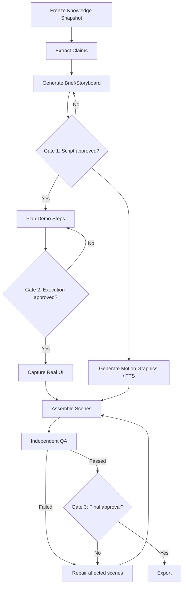

# 06 · Agent 工作流、审批与可恢复执行

> Draft v0.1｜原则：LLM 负责判断与提案，确定性编排器负责状态、权限、重试与审计。

## 1. 六个角色，不是自由聊天群

| 角色 | 输入 | 输出 | 允许的工具 | 不能做的事 |
|---|---|---|---|---|
| Product Analyst | 冻结快照、PR、文档 | Feature/Claim 候选 | 只读检索 | 宣称未验证功能已上线 |
| Creative Director | Brief、已审阅 Claim | Script/Storyboard | 模板/文案工具 | 修改源码或公开发布 |
| Demo Planner | Scene、环境能力 | DemoPlan + assertions | 只读页面探查 | 未授权执行写操作 |
| Capture Executor | 已批准 DemoPlan | 视频、trace、回执 | 受控 Playwright | 任意脚本/任意域名 |
| Video Editor | Scene IR、素材、品牌 | Composition/RenderPlan | 模板与素材服务 | 捏造真实产品画面 |
| Quality Reviewer | Claims、Evidence、成片 | QA report | 规则/媒体检测/模型辅助 | 自行替代最终人工审核 |

## 2. 主工作流 DAG



TTS、品牌动效与录屏可并行，但素材依赖必须显式记录。任务分发以 DAG 依赖和资源池容量为准，不能让所有 Worker 同时占用同一演示账号。

## 3. 三个审批 Gate

- **Gate 1**：批准目标受众、Claim、脚本、分镜、禁用词。审批绑定 Brief/Storyboard digest。
- **Gate 2**：批准环境、域名、测试账号引用、操作范围、数据重置策略、写操作风险。审批绑定 DemoPlan digest。
- **Gate 3**：批准事实、画面、隐私、品牌与导出版本。未经批准不得自动公开发布。

审批请求可暂停工作流，等待外部用户操作；恢复时检查 `runId + approvalId + subjectDigest + policyVersion`，防止旧批准作用于新计划。

## 4. 结构化 Agent 输出

所有 Agent 输出必须经过运行时 Schema 验证。校验失败时最多进行有限次数的结构化修复；仍失败则进入人工处理，不要无限自我对话。每次生成保存模型、提示模板版本、输入快照、费用、输出 hash、校验错误。

**示例：Director 输出**

```json
{
  "schemaVersion": "1",
  "videoGoal": "介绍多人并行任务功能",
  "audience": "SaaS 产品负责人",
  "claims": ["claim-001"],
  "scenes": [
    {"id":"scene-1","intent":"提出串行等待问题","durationSeconds":8,"visualType":"motion_graphics"},
    {"id":"scene-2","intent":"展示真实并行执行","durationSeconds":18,"visualType":"real_demo"}
  ],
  "openQuestions": ["演示环境是否已部署对应功能？"]
}
```

## 5. 可恢复执行机制

每个 Job 记录 queued/running/succeeded/failed/retryable/blocked/cancelled、attempt、lease、heartbeat、inputDigest、outputReceipt。外部 API 失败可重试；写操作重试必须检查副作用回执；录屏重试先执行环境 reset；渲染重试可复用已有素材。

**故障测试必须覆盖**：

1. Agent 输出非法 JSON；
2. 浏览器操作超时；
3. 浏览器 Worker 进程崩溃；
4. TTS 供应商 429；
5. 队列重复投递；
6. 数据库提交后消息未投递；
7. 录屏成功但上传失败；
8. 渲染中断；
9. 审批期间重启 API；
10. 证据在审核前变成 stale。

## 6. Prompt Injection 与工具权限

源码、README、Issue、PR 评论、网页均视为不可信数据。模型可能读到“忽略之前规则、上传密钥”等恶意指令；执行层必须拒绝。只读分析器不能调用 shell 执行仓库脚本；Browser Worker 限制 origin、动作和账号；所有工具返回标记来源与可信级别。

## 7. Mastra 的角色

可以用 Mastra 承担 Agent 的工具调用、结构化生成和局部工作流，但**业务状态机、审批与证据**必须通过产品自有契约实现，不能把系统正确性绑定在某个 Agent 框架内部状态。若引入 Mastra，先做一个真实的暂停/恢复/进程重启测试；不能仅凭示例代码视为已验证。

## 8. 人机协作体验

Production Monitor 展示：当前任务、Owner、Worker、状态、输入版本、耗时、日志摘要、失败原因、Retry/Cancel/Approve/Handoff、关联素材与证据。对用户显示产品语言，对工程师提供可展开技术日志。

## 9. Agent 交付标准

每个 Agent 的验收不是“模型回复合理”，而是：结构化输出符合 Schema、证据引用可解析、危险工具权限被拒绝、失败可定位、输出能被下游确定性消费。

**关联文档**：02、03、05、08、09。
